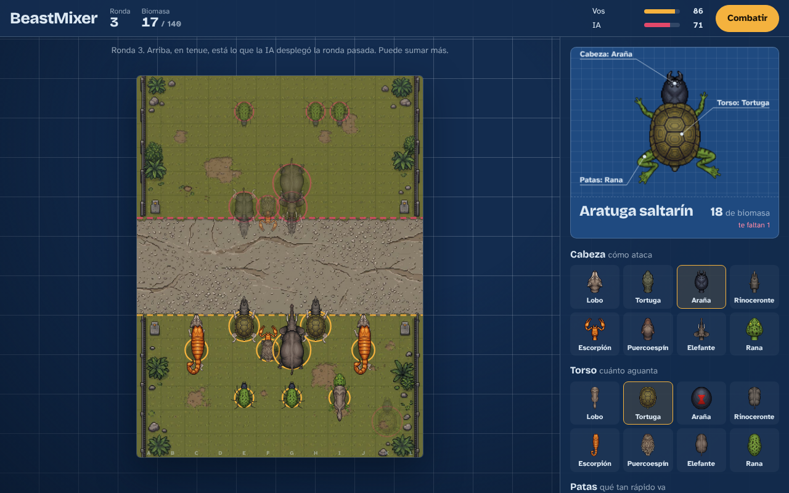
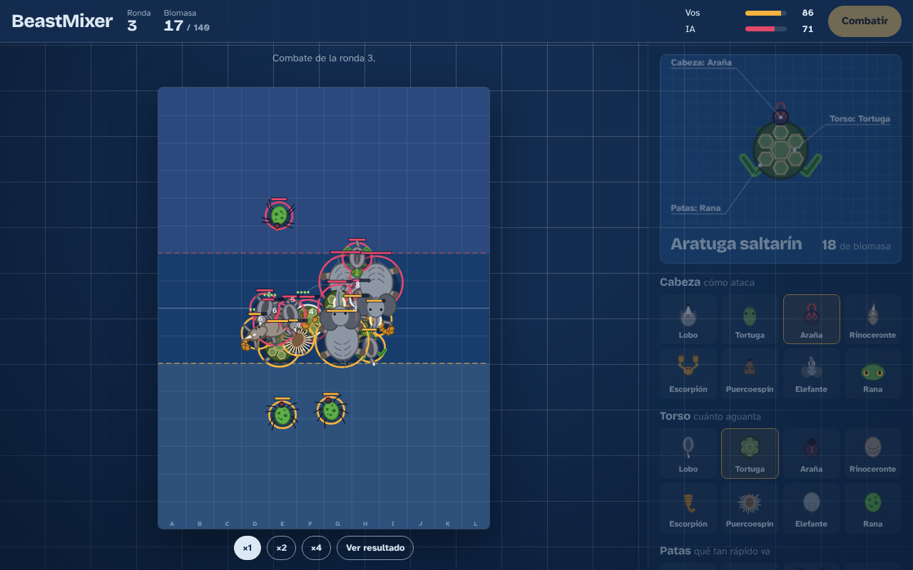
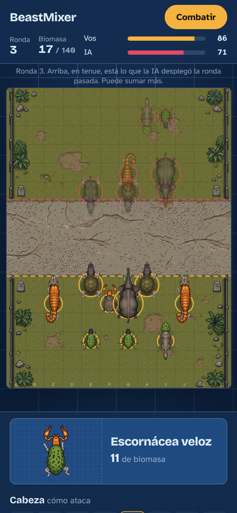

# BeastMixer

**Mezclá animales, armá un ejército de bestias imposibles y mirá cómo pelean solas.**

Un auto-battler táctico que se juega en el navegador, en la computadora o en el celular, y que se puede jugar con amigos por turnos, mandándose un link.

**Jugar:** https://juanmcompa.github.io/BeastMixer/



## La idea

En 2003, *Impossible Creatures* proponía algo que ningún otro juego de estrategia hizo igual: en lugar de elegir unidades de una lista, las inventabas. Tomabas dos animales, decidías qué parte del cuerpo aportaba cada uno y salía una criatura nueva, con las fortalezas de los dos. Un tiburón con trompa de elefante. Un rinoceronte con brazos de babuino.

Años después, los *auto-battlers* como *Mechabellum* demostraron otra cosa: que la estrategia puede estar entera en la preparación. No se controla a las unidades durante la batalla. Las decisiones son qué armar, dónde ubicarlo y cómo responder a lo que hizo el rival la ronda anterior. Después, el combate se juega solo.

**BeastMixer junta esas dos ideas.** Del primero toma el laboratorio: cada bestia es la cabeza de un animal, el torso de otro y las patas de un tercero. Del segundo toma el tablero por rondas: tu ejército se queda de una ronda a la otra, cada ronda tenés más recursos y el desafío es contrarrestar al rival.

Además está pensado para jugar con amigos sin coincidir en horario: cada uno juega su turno cuando puede, por WhatsApp, sin cuentas, sin descargas y sin servidor.

## Cómo se juega

1. **Diseñá.** Elegí cabeza, torso y patas entre ocho animales. La cabeza define cómo ataca (mordida, veneno a distancia, carga, golpe en área). El torso define cuánto aguanta (vida, armadura, espinas). Las patas definen qué tan rápido va. Cada combinación tiene su nombre: una cabeza de araña sobre un caparazón de tortuga con patas de rana es una *Aratuga saltarín*.
2. **Desplegá.** Cada diseño que guardás queda en **Mis bestias** durante toda la partida. En el campo elegís una y tocás casillas de tu mitad del tablero para ubicar copias. Cada una cuesta biomasa; cada ronda recibís más y lo que no gastás se guarda.
3. **Mirá el combate.** Las bestias avanzan y atacan solas al enemigo más cercano.
4. **Mejorá y contrarrestá.** Podés subir de nivel un diseño (todas sus copias mejoran) o reciclar bestias: lo comprado esta ronda devuelve todo, una veterana devuelve la mitad. Mientras preparás la ronda ves lo que el rival desplegó en la anterior, pero no lo que agregó después. El caparazón frena los mordiscos rápidos, el veneno atraviesa la armadura y los animales veloces alcanzan a los que atacan de lejos.
5. **Ganá.** Quien pierde una ronda pierde vida según cuántas bestias rivales quedaron en pie. Gana quien deja al otro en cero.

| Combate | En el celular |
|---|---|
|  |  |

## Modos

- **Contra la IA**, en cuatro dificultades. Desde Rival para arriba, la IA prueba decenas de ejércitos posibles simulando el combate contra lo que le mostraste y se queda con el que mejor te gana. Experto además anticipa tu respuesta; Pesadilla evoluciona su ejército ronda a ronda.
- **Duelo con un amigo.** Desplegás tu ronda y le mandás el link. Tu amigo despliega la suya, ve el combate y te devuelve otro link. Así hasta que alguien gana.

## Estado del proyecto

Es un **prototipo jugable**. Sirve para probar si la idea es divertida antes de invertir en arte y contenido.

Lo que hay:

- 8 animales, 3 partes cada uno: 512 bestias posibles
- 10 habilidades (veneno, caparazón, espinas, carga, salto, manada y otras)
- Niveles por diseño y reciclaje con costo para las veteranas
- IA en cuatro dificultades que piensa simulando combates
- Partidas contra la IA y duelos asíncronos por link
- Funciona en computadora y celular, sin instalar nada

Lo que viene:

- Más animales, con roles nuevos (voladores, excavadores, sanadores)
- Animaciones de ataque y muerte, y más mapas
- Mutaciones: elegir 1 de 3 genes por ronda para un diseño
- Desbloqueables entre partidas que sumen opciones, no poder
- Un servidor chico para que el duelo oculte de verdad el ejército rival

El detalle (alcance, decisiones y hoja de ruta) está en [docs/DISEÑO.md](docs/DISEÑO.md).

## Cómo está hecho

HTML, CSS y JavaScript sin dependencias ni compilación. Dos decisiones lo hacen funcionar:

- **El combate es determinista.** Usa un paso de tiempo fijo, un azar con semilla y operaciones que dan el mismo resultado en cualquier navegador. Los mismos dos ejércitos producen siempre el mismo combate, en cualquier dispositivo. Por eso el duelo no necesita servidor: cada jugador re-simula el combate y ve exactamente lo mismo que el otro.
- **Las bestias se arman por piezas.** Cada animal tiene cuatro sprites vistos desde arriba: cabeza, torso, pata delantera y pata trasera. El juego los encastra en tiempo real usando puntos de anclaje (cuello, hombros y caderas) y escala cada pieza según el torso que la recibe, así que las 512 combinaciones aparecen sin dibujar ninguna a mano. Las patas se espejan para el otro lado y se balancean al caminar.

```
index.html              página y pantallas
css/estilo.css          estilos
src/data/animales.js    todos los números del juego: partes, habilidades y reglas
src/core/               lógica pura: ensamblaje, simulación, economía, duelo e IA
src/render/             armado de las bestias con sprites y dibujo del tablero
assets/                 sprites de las piezas y mapas, listos para el juego
arte/fuentes/           imágenes originales con fondo magenta
tools/procesar_arte.py  recorta las piezas, quita el fondo y calcula los anclajes
src/ui/juego.js         flujo de la partida e interacción
tests/                  tests de simulación, economía e IA (npm test)
docs/DISEÑO.md          documento de diseño
docs/ARTE.md            cómo se generó el arte y cómo sumar animales o mapas
```

### Correrlo en tu compu

Descargá el repositorio y abrí `index.html` en el navegador. Para correr los tests hace falta [Node.js](https://nodejs.org):

```
npm test
```

Para cambiar el balance, editá `src/data/animales.js` y volvé a correr los tests: verifican, entre otras cosas, que las tortugas les ganen a los lobos, los lobos a las arañas y las arañas a las tortugas.

## Créditos

Diseño y desarrollo: **Juan M. Comparini**.

Sprites y mapa generados con IA (Nano Banana, de Google) a partir de los prompts de [docs/ARTE.md](docs/ARTE.md), y procesados para el juego.

BeastMixer es un proyecto independiente inspirado en *Impossible Creatures* (Relic Entertainment, hoy de THQ Nordic) y en *Mechabellum* (Game River). No está afiliado con esos juegos ni con sus dueños, y no usa sus nombres, personajes, arte ni código.
